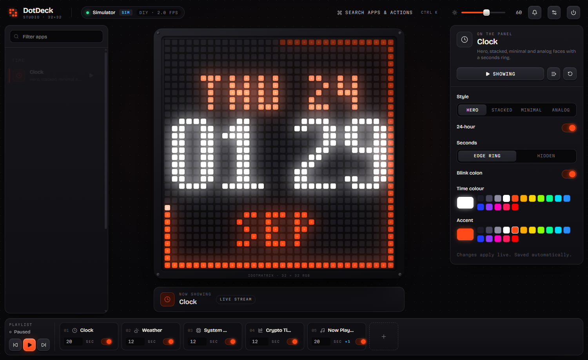

# Studio UI & UX system

The studio (`web/`) is the controller. Its centrepiece is the panel itself.



## Concept: two rooms, one instrument

**Dark — "instrument panel".** A piece of studio hardware rather than a web dashboard: machined graphite surfaces,
engraved monospace labels, hardware keys that depress, faders like a mixing desk, and **one** accent colour — ember
`#ff4818`, the same colour as the brand LEDs.

**Light — "gallery".** The same instrument on a gallery wall: porcelain / ivory layers (never flat white everywhere),
deep ink type, hairlines and long, soft warm shadows instead of heavy borders. The accent becomes the brand **rose**
re-tuned for white (AA as text), and **gold** is a metal only (the logo plate's rim, stars, the header hairline) —
never body text. Keys are bevelled white enamel with a 1 px floor; the primary key is glossy rose lacquer; toggles fill
with lacquer; fields and segmented controls are inset wells; dialogs float on a warm umber scrim. The page is linen
paper in daylight (dot grid, washes of rose and gold, a vignette); cards lift on three-layer warm shadows with a
white rim and a gilded hairline where dark has lit edges; the selected tab, chip, card and row carry the accent as a
tinted wash, edge and halo; section heads carry a gold-leaf jewel and a fading gilded rule.

In dark mode the LED preview sits in a graphite bezel with screws, a recessed well, per-LED bloom and a diffuser
sheen. In light mode it becomes a **paper panel** (§ Paper panel below): white enamel, a porcelain LED grid and every
colour re-mapped to read as ink on it — the same instrument, made for daylight (Display menu → *Panel preview in light
mode* → *Dark device* keeps the black device). The DeskDot LED logo follows: in light it is drawn in its `paper` style
(deep rose and gold dots), straight on the header — no sign or plate behind it in either theme.

**Liquid Glass.** Over both rooms, the navigation and control layer — bars, toolbars, the tab bar, sheets, menus,
popovers, dialogs, toasts, the playback dock, the panels around the LED panel, and every control — is Liquid Glass
(§ Liquid Glass): it blurs and bends what is behind it, catches the light on its rim, and controls squash and spring
back. Light mode has no dark chrome at all: the only dark things are the *Dark device* choice, the fruit fly's 3D
scenes (renders, like a video) and the games' own colours (black roulette pockets, black chips, cards).

## Themes (`lib/theme.ts`, `web/index.html`)

- **One switch:** `light` · `dark` (the first-run default, 3.9) · `system` (Auto). Stored in `localStorage["deskdot.theme"]`; applied as
  `<html data-theme="light|dark">` + `color-scheme` **before first paint** by the inline script in `web/index.html`
  (and `launcher.html`; on the website's `/app/`, whose CSP blocks inline scripts, `webapp/host.js` does it first).
  `installTheme()` (main.tsx) keeps it live: the OS flipping light/dark while on `system`, and other tabs changing it.
- **Where:** Settings → Display & colour → **Studio theme** (three picture tiles), the Display menu (gear) →
  *Studio theme* (Light · Dark · Auto), the phone **Quick controls** sheet, and on phones the **theme key**
  (`components/ThemeFab.tsx`): a 44 px round key pinned bottom-left just above the tab bar — one tap flips light ↔
  dark (an explicit choice, `toggleTheme()`), a long press (or right-click) opens Light · Dark · Auto with a check; an
  "A" badge shows while on Auto. The scroll areas end with a 52 px spacer so it never hides the last row; on the
  Settings tab it sits above the docked Show / Playlist bar. The top bar stays at five controls.
- **Android app:** the whole window follows — `syncSystemBars()` (`lib/android.ts`) calls
  `DeskDotAndroid.setBars(status, nav, page, lightIcons)` on every theme change: the status bar takes the header
  colour (`chassis-1`), the navigation bar the tab bar's (`--m-glass`), the window background the page
  (`chassis-0`), and the bar icons turn dark on light. The app remembers it, so the next cold start opens in the same
  colours (first start: Cyber grid, dark — the studio's first-run look) — no black flash. android/README.md.
- **Every page shares the key** — casino.html, controller.html, the join pages and the TV read `deskdot.theme`
  (same origin as the studio when served by the engine), else `prefers-color-scheme`; the TV defaults to dark.
- **Components never hardcode colour.** Use the tokens below (Tailwind utilities resolve per theme), the `--m-*`
  materials in plain CSS, `light:` / `dark:` variants for the rare theme-only tweak, and `.theme-dark` on a subtree
  that must stay dark in both themes — now only the fly's 3D scenes (`.fly-wing`, `.fly-pane`, whose HUD reads on the
  dark render) and `.bezel` while light mode keeps the dark device get it. Never use it for chrome or badges: light
  mode has no dark chrome (badges over thumbnails are `.lg-badge`, veils over the panel `.lg-veil`). Seat
  colours, LED palette swatches and canvases are data, not chrome.
- Theme changes cross-fade (`html.theme-fade`, 0.35 s; never on first paint, off with reduced motion). Live panels,
  image thumbnails and the header logo cross-fade their pictures too (§ Paper panel).

## Page themes (`lib/pageTheme.ts`, `gfx/themes.py`)

Light / dark is *how bright* the studio is; the **page theme** is *its colours*. Since 3.9 the page themes **are the
casino's 21 table themes** (`gfx/tables.py` `TABLE_THEMES`: same ids, names and descriptions — `classic` Classic green,
`royal`, `crimson`, `midnight`, `strip`, `emerald`, `burgundy`, `noir`, `jade`, `deco`, `marigold`, `diwali`, `cyber`
Cyber grid — **the default** —, `arcade`, `sakura`, `arctic` Glacier, `oasis`, `abyss`, `volcano`, `galaxy`,
`riverboat`), so the studio, the casino and the website (its copy's `scripts/site_theme.py`, `deskdot.siteTheme`) can't
drift. First run: Cyber grid, **Dark** (studio, web app, Android app); saved choices are kept. Ids from before 3.9 map to
the nearest table (`gfx/themes.py` `LEGACY`: `ember` → `cyber`, `graphite` → `noir`, `sunset` → `volcano`, `citrus` →
`arcade`, `glacier` → `arctic`) on the engine and in the browser.

- **Dark is the table's dark casino, exactly** (`themes.py` `_dark`, the values casino.css uses for `html[data-cz]` and
  the wings): the chassis is the table's room and surfaces (`bg`, `surface` … `surface4`), lines are the surfaces lit
  14 / 24 % by the accent, the inks are the casino's felt-tinted inks (AA-checked), `ember` / `ember-2` /
  `ember-deep` are the table's accent / highlight / deep, the page glows with the felt and carries the felt's motif
  (`--m-texture`) over the dot grid. **§ TABLE ROOM** in index.css then makes the floating panels the casino's
  wings (the wing gradient lit from the top, an accent hairline, the motif faint inside — tokens `--pt-wing*`,
  `--pt-acc-rgb`, `--pt-motif*`), the bars' capsules take the accent hairline, and segmented controls and the
  library's chips are the casino's tab rails with lit accent keys.
- **Light is the casino's porcelain salon** (`_light`, casino.css `:root[data-theme="light"][data-cz]`): porcelain
  washed in the table's colour (the accent when the felt is a graphite), the accent deepened to bronze until it reads
  AA on every surface and under white lettering, gold leaf in the accent, the motif inked faintly.
- **Generated, not mirrored:** `scripts/gen_page_themes.py` writes `web/src/lib/pageThemes.gen.ts` (names, swatch
  colours, bar colours and each theme's stylesheet) and `web/src/pageTheme.default.gen.css` (Cyber grid, also for a
  page with no `data-page-theme` yet — a first visit paints it before any script). `tests/test_page_themes.py` fails
  when they are stale, checks the tokens (casino-exact dark chassis, AA text, gradient-only textures, light overrides
  every dark token) and the LED rules.
- **Scoped and separate from the casino:** the CSS is scoped to `:root[data-page-theme="<id>"]:not([data-cz])`
  (+ `[data-theme="light"]`, + the `.theme-dark` / `.bezel` subtrees, which keep the dark accent in light). While the
  casino view is open (`html[data-cz]`) the table on screen owns the page, as before; casino.html and the TV never load
  a page theme. The top bar's gold **Casino** key is always classic gold (`.cz-gold-top` pins its gold tokens, so a page
  theme's `--gold` can't leak into its gradient).
- **Stored on the engine** (`POST /api/theme`, `state.settings.page_theme`), so every device, phone and the Android app
  show the same theme; `main.tsx` follows the state push (`syncPageTheme`; a push older than this tab's own pick is
  ignored for 4 s). This browser keeps a fallback copy: `localStorage deskdot.pageTheme` + the generated CSS in
  `deskdot.pageThemeCss`. An engine that doesn't know themes keeps the pick local (the picker says so). In the web app
  (idotmatrix.com/app/) the website's pick (`deskdot.siteTheme`, same origin) leads: /app opens in the table the site
  was showing (the browser engine is told), and a pick in /app is written back for the site.
- **No flash, no jump:** `index.html` and `launcher.html` paint the cached CSS before the first frame (a `<style
  id="dd-page-theme">`); `webapp/host.js` and `controller.html` do the same with a constructed stylesheet (CSP-proof).
  At run time the CSS lives in one `document.adoptedStyleSheets` sheet (a `<style>` where unsupported). A change
  cross-fades the whole page with a View Transition (`html.page-theme-vt`, 0.42 s; washes and textures included),
  else the `html.theme-fade` transitions; instant with reduced motion. Colours only — no size or layout changes.
- **Bars:** `meta[name=theme-color]` and the Android status / navigation bars use the theme's tinted page, header and
  tab-bar colours (`pageBars()`), on every theme or mode change.
- **Where:** Settings → Display & colour → **Page theme** (`components/PageThemePicker.tsx` `PageThemeGrid`: a scrolling
  grid of picture tiles — the page with its motif, a card, the accent bar and key, the metal gem — in the mode on
  screen, three LED dots with the panel colours from `/api/theme`, a check on the current one, and the hovered /
  focused theme's description below), the Display menu and the phone **Quick controls** (`PageThemeDots`: a wrapping
  row of round accent / metal swatches; 32 px on touch screens). The Studio theme tiles draw in the page theme too.
- **Phone controller / join:** `controller.html` follows the cached theme (its `--ember`), same origin as the studio.

## Paper panel (light mode's LED preview — `lib/paper.ts`, `lib/paperImg.ts`)

The panel is emissive: colours glow on black. On an ivory page a black square with neon in it is the loudest thing on
screen, and naive inversion breaks colours (yellow turns blue). So in light mode the studio draws a **paper panel** —
how the frame would look printed in ink on porcelain. **Only the studio's drawing changes**: the panel, the engine's
frames, `/api/frame.png` and the preview GIFs are untouched.

**The mapping** (`paperColor(r, g, b)`, OKLab / OKLCH, cached per exact colour — `paperOf`, a `Map` capped at 65 536
entries; a 32×32 frame uses a few dozen colours, so a frame costs 1 024 lookups):

1. *How lit* — `v` = the brightest channel (0..1); below 3/255 the pixel is unlit → the ground `#ebe6dc`.
2. *Its ink* — the full-drive colour (`rgb / v`): neutrals (HSV saturation 0) → the studio ink `#1c1a22`; chromatic
   colours keep their OKLCH hue and their chroma relative to the sRGB gamut, at a lightness of 0.47 (blue) … 0.62
   (yellow) by the colour's own lightness, then darkened step by step until it reads at **≥ 4.5:1 against the unlit
   LED**. Yellows lean up to 14° toward gold (darkened yellow reads olive otherwise). Pastels blend between the two by
   saturation (near-white pink → near-black wine).
3. *Where between* — ground → ink by `a = 1 − (1 − v)²` in lightness and `a^0.55` in chroma (easing to `a` for
   near-black, ≲ 3 % lit, so a backdrop that looks black on the panel stays the plain ground): brighter on the panel =
   darker on paper, so every app's contrast order holds (content stays darker than any dim backdrop behind it); dim
   pixels (glow, trails, anti-aliasing) stay smooth gradients and clearly coloured tints.

| LED colour | Paper | Contrast on the unlit LED |
| --- | --- | --- |
| white `#ffffff` | `#1c1a22` | 13.8 |
| black `#000000` | `#ebe6dc` (the ground) | — |
| red `#ff0000` | `#c10000` | 5.2 |
| yellow `#ffff00` | `#786500` | 4.6 |
| cyan `#00ffff` | `#007373` | 4.6 |
| blue `#0000ff` | `#0033f2` | 6.1 |
| dark red `#400000` | `#f58976` | 1.9 (a dim red stays a lighter red tint) |
| grey `#808080` | `#48464c` | 7.5 |
| magenta `#ff00ff` | `#b400b4` | 4.7 |

**The looks** (`components/LedPanel.tsx`): *Glow* — crisp mapped pixels over the ground, with the frame blurred small
and **multiplied** in (a soft coloured halo that darkens instead of blooming white); *Pixel* — crisp, no halo; *LED*
— ink dots in a light housing (`#f8f5ef`; unlit LEDs are shallow porcelain dimples, a cached layer like the dark one)
with a faint multiply halo under them. Calibration ("Show my colour calibration") is applied first, then the mapping.
The light `.bezel` turns white enamel with a porcelain well and brass-and-ivory screws — every bezel, the casino's
(`.cz-bezel`, on a brass rail and the table's felt) and the fly view's full-screen panel included. The one exception
that keeps the emissive device: `raw` panels (the calibration wizard's screen reference, which must show what the LEDs
emit), set in a light frame. The AI creator's preview and the Now Playing layout pictures are paper too.

**Image previews** — library tiles, AppRail cards and the casino's game tiles (`.led-preview > img`) and the launcher
(`.lx-led > img`) are `` GIFs/PNGs. `installPaperImages()` lays a `canvas.paper-img` over each one (no component
changes): it fetches the image once, decodes GIFs itself (all disposals, transparency, interlace), maps every frame
once (cached per URL, the 48 most recent kept) and plays them on one shared timer that wakes only when a visible
canvas's next frame is due (IntersectionObserver; nothing while hidden or while paper is off). The `.led-mask` dot
grid takes its gap colour from `--led-gap` (a registered `<color>`, porcelain in paper) so it fades with the theme.
Preset covers tint with `--led-paper` (the tone taken toward ink).

**Switching** — `<html data-panel="paper|device">` (set by `installPaper()`, which follows `<html data-theme>`; paper =
light theme + the Paper choice). Every live panel cross-fades: the old picture is copied onto an overlay canvas that
fades out over 0.42 s while the new one is drawn at once (`crossFade()`); image tiles fade their canvas over the
image (the image hides only after the fade); the header logo cross-fades the same way. Instant with reduced motion.

**The choice** — Display menu → *Panel preview in light mode*: **Paper** (default) · **Dark device**, per browser
(`localStorage["deskdot.panelLight"]`, `usePanelLight()` / `setPanelLight()`), included in the menu's Reset.

**The logo** (`lib/logo.ts`): two styles as data — `NEON_STYLE` (additive halos, white-hot core; tubes `LOGO`) and
`PAPER_STYLE` (tubes `#c2154d` rose / `#996300` gold, ≥ 4.5:1 on porcelain; unlit dots a faint warm grey; a multiply
halo; a soft sheen for the core). `NeonLogo.setLook("neon" | "paper")`; `NeonMark` follows `<html data-theme>`. The
plain-JS copies (`// <deskdot-logo>`) carry both styles; `mount()` follows its page's own light / dark live
(`opts.light`, else a shadow host's or `<html>`'s `data-theme`, else the system). No page puts a sign or plate behind
the logo (the old `.led-plate` / `PAPER_PLATE` are gone): it sits straight on its header. `tests/test_logo_copies.py`
keeps both styles identical everywhere.

## Liquid Glass (`index.css` § LIQUID GLASS, `lib/glass.ts`)

Our own CSS/SVG after Apple's published principles (WWDC25 "Meet Liquid Glass", HIG → Materials). Apple's design kits
are licensed only for designing apps on Apple platforms, so nothing of theirs is downloaded or embedded.

**Principles we follow.** Glass is the navigation and control layer floating above content — never the content itself
(tiles, cards, the LED panel), and never glass on glass (a panel inside a panel is a plain raised fill). It blurs and
saturates what is behind it, bends it near the edges (a lens), carries a specular rim lit from the top-left plus a
highlight that follows the pointer (or the phone's tilt), has inner light and shade for thickness and soft depth
shadows, adapts its tint to light / dark and the page theme, uses capsules for controls and concentric, larger radii
(sheets 34 px, the tab bar 30 px, panels 14–22 px), and morphs: a selection lens stretches in and settles
(`lg-morph`), pressed controls squash and spring back (`--lg-spring`).

**Tokens** (`:root` / `:root[data-theme="light"]`, mixed from the chassis tokens so every page theme tints them; also
declared on `.theme-dark`; the phone pages, the web app, the launcher and the TV mirror the names):

| Group | Names |
| --- | --- |
| body | `--lg-tint` (regular), `--lg-tint-thick` (text-heavy), `--lg-frost` (fallback, near opaque), `--lg-solid`, `--lg-blur` 20 px / `--lg-blur-thick` 28 px, `--lg-sat` 1.8, `--lg-glare` (top sheen), `--lg-inner` (thickness) |
| rim | `--lg-edge` / `--lg-edge-strong` (hairline), `--lg-rim-a` (lit edge), `--lg-rim-b` (shade), `--lg-rim-c` (far-edge bounce), `--lg-spec` (pointer spot) |
| depth | `--lg-shadow`, `--lg-shadow-lift` (menus, sheets, the tab bar) |
| controls | `--lg-control` (+ `-hover`, `-sheen`, `-rim`, `-shadow`, `-shadow-press`), `--lg-prominent-sheen` (tinted glass), `--lg-track` / `--lg-track-shade`, `--lg-lens` (+ `-rim`, `-shadow`), `--lg-knob` / `--lg-knob-held` / `--lg-knob-edge`, `--lg-spring` |

**Classes.** `.glass` (regular: toolbars, bars), `.glass-thick` (sheets, menus, popovers, dialogs, toasts),
`.glass-capsule` (toolbar groups), `.glass-control` (keys, chips: translucent fill + rim + sheen, *no* backdrop blur —
controls are many and small), `.glass-lens` (the selection), `.lg-badge` (small glass capsules over thumbnails and the
panel: LIVE, ▶, delete, the look switch), `.lg-veil` (a dim / frosted veil over the live panel), `.lg-toolbar` (keys
inside a capsule go clear until hovered). The element is transparent and isolated (a stacking context, *not* a
containing block, so fixed popovers and sheets inside still cover the screen); `::before` is the body (tint + sheen +
inner light + `backdrop-filter: blur() saturate()`), `::after` the 1 px gradient rim (mask ring). A glass group that
holds an open menu raises itself (`:has([role=menu|dialog|listbox])`); the header sits at `z-index: 30`.

**Where.** `.surface` *is* thick glass (library, inspector, fly dock, the stage's cards, every menu / popover / dialog /
toast, the playback dock); the header's status pill and its toolbar (search · brightness · Display menu · power guard)
are glass capsules and the header rule is gone; phones: the header bar, the floating capsule tab bar (content scrolls
under it; the open tab is a lens that morphs in), floating sheets, the theme key and its menu, the "now showing"
strip, Quick controls tiles; keys are capsules (`.key-ember` = prominent tinted glass), `.seg` a capsule track with a
lens, `.toggle` Apple's switch (the knob stretches while held), `.fader` a glass knob that swells while held, chips
and dock presets glass controls. Casino wings: a pale glass rail with a glass tab track. The launcher's bar is a slab
of glass in a browser tab (frosted inside the `deskdot launcher` window, which can't blur the desktop). Phone pages
(casino.html, controller.html, join), the web app (`host.css`) and the TV mirror the tokens in their own CSS.

**Modes and fallbacks** — `<html data-glass>` (set before first paint by the inline script in `index.html` /
`launcher.html`, refined by `installGlass()`; the Display menu → More → **Glass** forces one per browser,
`localStorage["deskdot.glass"]` = auto | liquid | frosted | solid):

| Mode | When | What |
| --- | --- | --- |
| liquid | blur supported, not the Android app, not a low-end device | real blur; `html.lg-lens` adds the SVG edge lens (`backdrop-filter: url(#lg-lens) …`, an `feDisplacementMap` injected by `lib/glass.ts`) on Chromium with a fine pointer |
| frosted | no `backdrop-filter`, `window.DeskDotAndroid` (its WebView let content show through translucent bars), ≤ 4 GB or ≤ 4 cores, or chosen | no backdrop-filter, `--lg-frost` (98 % dark / opaque light): text never sits on raw content |
| solid | `prefers-reduced-transparency` or chosen | opaque fills, quieter rims |

Touch screens keep real blur only on the small fixed bars (tab bar, phone header); panels, sheets, dialogs, veils and
badges are frosted there — a blur re-renders on every scroll frame and whenever the live panel behind it changes.
`@supports not (backdrop-filter…)` and `@media (prefers-reduced-transparency)` guard the CSS without JS. Glass panels
rise in with a transform-only animation (`lg-rise`): an opacity animation makes the element a backdrop root and its
blur would see nothing. The TV gets static faux glass only (no `backdrop-filter`, docs/TV_VIEW.md §6).

## Tokens (`web/src/index.css` → `@theme` + `:root[data-theme="light"]`)

| Token | Dark | Light | Use |
| --- | --- | --- | --- |
| `chassis-0` | `#08080a` | `#f4f0e8` porcelain | page, inset wells (fields, segmented) |
| `chassis-1` | `#0f0f13` | `#fbf9f5` ivory | panels |
| `chassis-2` | `#16161b` | `#ffffff` | raised panel top, popovers |
| `chassis-3` | `#1e1e25` | `#f0ebe2` | hover fills, chips |
| `chassis-4` | `#27272f` | `#e6e0d5` | keys (dark), tracks |
| `line`, `line-2` | `#25252d`, `#33333d` | `#e7e1d6`, `#d8d0c2` | hairlines, control borders |
| `ink-1` | `#efece4` | `#1c1a22` (16:1) | primary text |
| `ink-2` | `#a9a7b0` | `#4a4652` (8.7:1) | secondary |
| `ink-3` | `#6f6d78` | `#6b6673` (4.7:1) | labels, hints |
| `ink-4` | `#484651` | `#a49ea8` | disabled, decoration only |
| `ember` | `#ff4818` ember | `#b81f4b` rose (5.5:1) | THE accent |
| `ember-2` | `#ff7a4d` | `#d6386a` | hover / glow (not small text) |
| `ember-deep`, `ember-line` | `#3a1208`, `#7a2a12` | `#fbe8ed`, `#edb9c7` | accent well + its border |
| `on-ember` | `#150502` | `#ffffff` | text on a solid accent |
| `gold`, `gold-2` | `#ffcc33`, `#ffe08a` | `#b8892a`, `#e6cd8a` | metal accent |
| `gold-text` | `#ffd600` | `#8a6412` (5.1:1) | gold as text (`.text-gold`) |
| `ok` / `ok-line` | `#3ddc97` / `#1f5c43` | `#18794e` / `#a8d8bf` | status |
| `warn`, `bad`, `info` | `#ffb020`, `#ff3b5c`, `#37c8ff` | `#9a5b00`, `#c8203e`, `#0b6f9e` | status only |
| `scrim` | `#000000` | `#ece6db` porcelain veil | dialog backdrops (`bg-scrim/60 light:bg-scrim/60` + a blur = frosted in light) |
| `font-display` | Bricolage Grotesque (variable) | | names, headings |
| `font-mono` | Martian Mono | | engraved labels, data, keys |
| radius | 14 px surfaces, 9–10 px controls, 5 px swatches | | |

Materials (`--m-*`, plain CSS): `--m-hi` / `--m-hi-key` (inner top highlight), `--m-surface-shadow`,
`--m-pop-shadow` (menus, dialogs), `--m-key-top` / `--m-key-bottom` / `--m-key-floor` / `--m-key-hover`, `--m-inset`,
`--m-glass` (tab bar, phone header), `--m-page-glow` / `--m-page-dots`, `--m-thumb-*` (fader knob),
`--m-bezel-shadow`, `--m-led-ring`, `--m-shimmer`.

**Materials v2** (`index.css` § MATERIALS v2 — same names in both themes; the plain-HTML pages, the launcher and the
web app's `host.css` mirror them by name). Light is as detailed as dark, but with what makes light rich — paper,
porcelain, lacquer and gold leaf — instead of glow:

| Group | Names | Light | Dark |
| --- | --- | --- | --- |
| atmosphere | `--m-daylight` `--m-wash-a` `--m-wash-b` `--m-vignette` `--m-texture` (+`-size`) `--m-linen` | daylight from the top, a rose bloom behind the panel, gold light in two corners, an umber vignette, a fine dot grid over linen | the ember glow and dot grid (unchanged) |
| depth | `--m-well-bg` `--m-well-shadow` · `--m-card-bg` `--m-card-shadow` `--m-card-shadow-hover` · `--m-raised-shadow` · `--m-bevel` `--m-rim` | page → inset well → porcelain card → raised key; three-layer warm umber shadows, white top rims, bevelled keys and chips | chassis gradients, black floors |
| metal | `--m-gold-leaf` `--m-brass` `--m-champagne` `--m-sheen` `--m-rule` `--m-rule-gold` `--m-emboss` | gold-leaf jewels and gilded hairlines, champagne medallions, a gloss sheen on lacquer (primary) keys, letterpress small caps | brass / gold for the casino, a faint sheen |
| accent | `--m-accent-wash` `--m-accent-edge` `--m-accent-halo` `--m-focus-ring` | the accent (rose; bronze in the casino view) as a tinted wash, border and coloured soft shadow on every selected thing | the ember wash and glow |

The accent / chassis mixes are declared on `:root`, `.cz`, `.theme-dark` and `[data-accent-scope]` — a custom property
computes where it is declared, so a subtree that re-tints `--color-ember` carries `data-accent-scope` to get matching
washes. Everything is static gradients (painted once); the only blur is Liquid Glass (§ Liquid Glass), with its
frosted fallback wherever blur is missing or slow.

Fonts are bundled with `@fontsource` — the studio works fully offline.

## Components (CSS classes in `index.css`)

| Class | What |
| --- | --- |
| `.surface` | machined panel: gradient, hairline, inner top highlight |
| `.engrave` | 9.5 px mono uppercase, 0.18 em tracking, `ink-3` — every label |
| `.key`, `.key-ember`, `.key-ghost`, `.key-icon` | glass capsule buttons (squash + spring on press); ember = prominent tinted glass, the one primary action in view |
| `.glass`, `.glass-thick`, `.glass-capsule`, `.glass-control`, `.glass-lens`, `.lg-badge`, `.lg-veil`, `.lg-toolbar` | Liquid Glass (§ Liquid Glass) |
| `.fader` | range input; set `--fill` to the percentage for the lit track |
| `.seg` | segmented control (≤ 4 options) |
| `.toggle` | switch; ember glow when on |
| `.field` | inset text/select/textarea |
| `.led[data-on=ok|warn|bad|ember]` | status dot |
| `.bezel`, `.screw` | the panel housing (graphite; white enamel + porcelain well with the paper panel in light; satin rim + long shadow) |
| `.led-preview`, `.led-mask`, `--led-gap`, `.paper-img` | image thumbnails of the panel, their LED dot mask (gap colour fades with the theme), the paper canvas laid over them |
| `.led-well` | the well behind a small live `LedPanel` (header mini panel, inspector, Display menu tiles): porcelain with the paper panel |
| `.theme-tile`, `.theme-swatch` | the Studio theme picker (`components/ThemePicker.tsx`) |
| `.pt-grid`, `.pt-tile`, `.pt-art`, `.pt-leds`, `.pt-dots`, `.pt-dot` | the Page theme picker (`components/PageThemePicker.tsx`) |
| `.theme-dark` | keep a subtree dark in both themes |
| `.studio-head`, `.lib-card` | header hairline (gold-tinted in light); library cards that lift on hover |
| `.icon-tile`, `[data-tone]` | tinted duotone icon tile and its tint families (see Icons) |
| `.picker-*` | the dropdown: trigger, popover list, phone sheet rows (see Dropdowns) |
| `.theme-fab*` | the phone's floating theme key and its menu |
| `.m-rule`, `.m-medallion` | a fading (gilded in light) hairline; the round empty-state badge (a champagne medallion in light) |
| `.lib-sechead`, `.lib-chip`, `.lib-card[data-live|data-sel]`, `.lib-row` | library ornaments: section heads with a gold jewel and a fading rule, chips, cards (live = lacquer wash + halo) |
| `.insp-head[data-tone]`, `.set-block`, `.set-nav`, `.modal-head`, `.dock-preset`, `.status-pill` | the settings panel's tinted crown, settings section cards and nav, the gilded dialog head, playlist preset keys, the connection pill |
| `.rail*` | the Panel tab's swipeable app rows |
| `.preset-*`, `.eq` | the Presets tab's cover cards, the "playing" bars |
| `.appicon*` | Settings → App icon tiles (Android app) |

## Layout

```
┌ TopBar: wordmark · status pill · Find anything (Ctrl K) · brightness · settings · power guard ┐
├ Library (300) ┬ Stage (flex): bezel + LED panel, context tools, now-showing + Create menu ┬ Inspector (340) ┤
└ Playback dock: transport · what's playing / next · shuffle · preset cards · Edit playlist (queue) ──┘
```

- **Top bar = five controls, no more.** Status pill (panel OK? → the **Connection** sheet, below; a Reconnect-now
  key appears when the link is down), Find anything (command palette), brightness, the gear (the **Display menu**, below — *All settings*
  is in it), the eject-seat power guard. Everything
  else lives in the command palette or a menu: *Send a message*, *Make with AI*, *Show a picture*, *Draw* and
  *Write text* and *Show on TV* (`components/TvSheet.tsx`: QR, address, TV code, screens watching, New code, Stop TV
  link — docs/TV_VIEW.md) are in the Stage's **Create** menu; **Release the panel** is in the Connection sheet and Settings →
  Device (with a warning, because the panel shows its pairing screen while released — ADR 0013).
- **One "what's playing" area.** The playback dock is the only place for rotation state: preset name or
  "Your playlist", current app + countdown + progress, *Next: …*, prev / stop / next, shuffle. Preset cards
  (icon, name, app count) play with one tap (`POST /api/presets/{id}/play`, honouring the shuffle pref); the
  active one glows ember. *Save as preset* names the current playlist; your own presets get a × with an inline
  confirm (also listed in Settings → Playlist & hand-off). *Edit playlist* expands the draggable queue.
- **Library** is grouped by category with sticky headers (Favourites first), a search with clear, a single
  scrolling row of category chips, grid/list toggle and a preview-size fader (grid only).
- **Inspector** shows the first 5 settings; the rest (and every `group`) sit behind **More options**.
- Rails are resizable but clamped (library ≤ 460 px, inspector ≤ 480 px) so the preview always stays the hero.
- ≥ 1280 px: three columns. 768–1279: Library + Stage; the Inspector opens as a right drawer (“Settings” on the
  now-showing card, or clicking an app).
- < 768 (phones) — an app shell, not a squeezed desktop (`App.tsx PhoneLayout`, `index.css` "phones" block):
  - **Header** (52 px + the notch inset): status dot, the logo, Search and one **⋯** key. Brightness, panel
    power, the fruit-fly toggle + flies-allowed sign, Device / Settings / Message live in the **Quick controls**
    bottom sheet (`TopBar.tsx QuickSheet`).
  - **Bottom tab bar** in the thumb zone — **Panel**, **Apps**, **Presets**, **Settings** — a floating glass capsule
    (content scrolls under it) with a glass lens behind the open tab that morphs in (the active glyph turns duotone);
    tapping the open tab scrolls it to the top.
  - **Panel tab** = one scroll area (`.phone-stage`): the panel at full width but at most 40 % of the screen height,
    its tools, the now-showing card, then **app rows** (`components/AppRail.tsx`) you swipe left / right —
    Favourites, Recent (`lib/recent.ts`, the last 16 apps shown, per browser), then one row per category. Native
    `scroll-snap` with momentum, edge-to-edge tracks with the next card peeking, rows off screen skipped
    (`content-visibility`), previews lazy. Tap a card = show it on the panel (tapping the live one opens its
    settings), hold = its settings; the row's count chip opens the Apps tab on that category.
  - **One scroll area per tab** (`.phone-scroll`), never scroll boxes inside cards. `Library flat`: sticky search +
    category chips, section titles stick under them, a dense 3-up grid (4-up ≥ 520 px) with a visible ▶ per tile.
    `Inspector flat`: the live panel in its header, the form in one card, **Show / Playlist** docked above the tab
    bar. Apps and Presets keep a slim "now showing" strip on top (tap = back to the panel).
  - **Presets tab:** cover cards in a 2-up grid (3-up ≥ 560 px) — an LED-equaliser cover drawn from the preset's id
    in its tint (the category most of its apps share; static SVG), the preset's icon as a solid tile, a "Playing"
    chip with animated bars, the name, up to three app glyphs, "N apps · M min", and one round play key (a stop key
    while it plays). Your own presets get a × on the cover with an inline confirm.
  - **Play mode** is a handheld console: score strip, the panel as big as fits, the pad — one screen, no scroll.
    Mode, match setup, restart / AI / fruit fly sit in the **Match** sheet (header ⚙ key).
  - Bottom sheets (`components/Sheet.tsx`: drag-to-close handle, ≤ 88 dvh, safe-area padding) replace pop-overs;
    modals are full-screen with the notch / home-indicator insets. `100dvh`, `viewport-fit=cover`, 16 px inputs (no
    iOS zoom), `touch-action: manipulation`, no tap flash, `overscroll-behavior` so pages never rubber-band.

## Icons (`components/Icon.tsx`)

One icon language everywhere — lucide glyphs (apps name theirs in Python, kebab-case), drawn two ways:

- `Icon` — the plain outline (1.6 stroke) for keys, inline hints, chevrons. `duo` = the **duotone** style: the outline
  (1.75) plus a 20 % fill of its shapes in the same colour.
- `IconTile` — a duotone glyph on a tinted, softly lit tile (radius 30 % of its size): app rows and headers, the
  now-showing card, presets, the queue, the Create menu, the palette, Quick controls, Settings. `tone` picks the tint;
  `solid` fills the tile (selected / playing).
- **Tints** (`[data-tone]` in index.css; each sets `--tint`, deep on ivory, and `--led`, always bright, for LED
  artwork): one per category — time amber · data cyan · media violet · creative rose · ambient teal · productivity
  lime · pets pink · games ember-orange · casino gold · device slate — plus `ember`, `gold`, `ok`, `info`, `neutral`.
  `CATEGORY_ICON` gives each category its glyph. Use a tile where an icon *names a thing*; a plain `Icon` inside keys.

## Dropdowns (`components/Picker.tsx`)

No native `<select>` in the studio chrome (the fruit-fly view's mini selects excepted). `Picker` takes
`{ value, label, hint?, icon?, tone?, swatch?, disabled? }[]`:

- **Touch screens / phones:** a bottom sheet titled with the field's label — 56 px rows with an icon tile or colour
  chip, the name, a description line, a check on the current one; a search box above 10 options.
- **Mouse:** an anchored list (below, or above when there's no room; follows scrolling) that works like a select —
  ↑ ↓ Home End, Enter, Esc / Tab, type a letter to jump; search above 10 options. `returnFocus={false}` drops focus
  after a choice (Play mode hands the arrow keys back to the game).
- Schema forms: an enum with more than 4 options is a Picker; `Name (detail)` labels split into name + description,
  host-blocked options show their platforms and are disabled.

## Connection (`components/ConnectionSheet.tsx`)

"Where is my panel connected, and how do I get it back?" in one place. The top bar's status pill (phones: the status
dot in the header) opens it; so does `#connection` in the URL (the web app links there when DeskDot on this computer
holds the panel). Wording comes from one function, `summarize()`, shared with the pill:

| Pill | When | Primary action |
| --- | --- | --- |
| `IDM-…` (green) | connected | — (secondary: Reconnect, Release the panel…) |
| Connecting… / Looking for panel… (amber) | an attempt is running | Reconnect now |
| Reconnecting… (amber) | the link dropped (`reason: link_lost`) | Reconnect now |
| Not connected / Bluetooth is off (red) | an attempt failed | Reconnect now |
| In use elsewhere (red) | not found 3× in a row (`busy`), or the web app saw DeskDot on this computer holding it | Reconnect now (after freeing it there) |
| Pick your panel (amber) | web app: no panel this browser may use yet, or the permission expired | Pick panel (the browser's chooser) |
| Released (grey) | the user released the panel | Use the panel here |
| On <device> (grey) | another DeskDot has it (`state.handover.holder`), or this one let it go for it (`moved_to`) | Use the panel here / Take it back |
| Moving here… (amber) | a hand-over is running | — (the steps show in the sheet) |
| Recovering… (amber) | `reason: recovering` — the engine is clearing old sessions and waiting for the panel | Reconnect now |

The sheet shows **what and where** (panel name and address; "DeskDot on this computer" / "This browser tab" / "The
Android app" / simulator), signal strength when known (`rssi`), connected-for or last-seen, failed attempts and the
countdown to the next one, the current step in the web app ("Waiting for IDM-… to show up"), the engine's `hint` in
a warning box with the raw error underneath, then **one primary button** (ember) and at most a few secondary ones.
*Release the panel…* opens an inline confirm that explains the pairing screen and that DeskDot stops reconnecting
until *Use the panel here*. In the web app it adds *Is DeskDot open on this computer?* (probes
`http://127.0.0.1:8765/api/health`), *Pick another panel* and the packet-size choice; the page host's floating pill
hides once the studio has mounted the sheet (`deskdotWeb.attachStudio()`).

**Hand-over (ADR 0015).** *DeskDot nearby* lists this DeskDot and every one on the network (laptop, phone, the browser
tab on this computer) with who has the panel, *Pair* for ones not paired yet (the code to confirm shows inline), and
"it was last with …" when nobody claims it. *Use the panel here* runs the hand-over; its steps show live with a
spinner / tick / cross — *Asking <device> to let go → Released → Waiting for the panel → Connected* — and a failed
step ends in one plain sentence plus **Try anyway** when the holder couldn't be reached. A pairing request from another
DeskDot shows as a card (also floating, bottom right, while the sheet is closed) with the code and *Allow / Don't allow*.
A checkbox at the bottom turns *Find other DeskDots on this network* off. In the web app the page host builds the same
list from DeskDot on this computer (`deskdotWeb.state().handover`, `deskdotWeb.useHere()`); without it, the sheet
explains that an https page can't reach the phone and how to release it there by hand. The Android app shows the same
sheet (it is the studio in a WebView).

## Display menu (`components/DisplayMenu.tsx`, `lib/look.ts`)

The gear just left of the power guard (and Play mode's look key) opens it: a popover on wide screens, a bottom sheet
on phones. The common case is one glance; nothing else is on the first screen.

1. **How the panel looks on this screen** — three picture tiles, **Glow** (soft light, default) · **Pixel** (sharp
   squares) · **LED** (like the real panel). Each tile is a tiny live `LedPanel` forced to that look, so you choose
   by seeing. The chosen one is ember; one line under them says what it is for.
2. **Glow** slider (Crisp … Soft, `bloom` 0..1, 0.5 = normal) — shown only while Glow is chosen, the only look it
   changes. Then *Studio theme*, *Panel preview in light mode* (**Paper** · **Dark device**, § Paper panel) and *Page
   theme*.
3. **More** (one disclosure, closed each time): *Show my colour calibration* (LED look only · Every look · Off —
   also in Settings → Colour calibration → Advanced) and links into Settings → Display & colour: *Brightness, night
   mode, rotate* (+ sounds, intro), *Colour calibration*, *Smooth motion*.
4. Footer: **Reset to default** (Glow, normal glow, calibration in the LED look, the paper panel; confirms inline,
   disabled when already default) and **All settings** (Settings → Display & colour — what the gear used to open directly).

Everything here is per browser (`deskdot.panelLook`, `deskdot.panelBloom`, `deskdot.panelMatch`,
`deskdot.panelLight`); `useLook().reset()` restores the defaults. The stage panel's hover pill (Glow / Pixel / LED) stays as a shortcut.
Keyboard: the key has `aria-haspopup="dialog"`/`aria-expanded`; opening focuses the chosen tile, Tab walks tiles →
slider → More → footer, tiles are `aria-pressed` toggle buttons (no arrow-key roving, so Play mode's arrows still
reach the game), `Esc` or a click outside closes and focus returns to the key.

## Play mode (`components/PlayMode.tsx`, `lib/gameInput.ts`)

A focused, full-window game view (`playMode` in the store) for every *playable* game — `isPlayable()`: category
`games` with the `demo` action (the `GameApp` base class), plus Snake (`arcade`). Game Deals / Trivia don't qualify.

- **Entry points:** the ember **Play** key on the stage's game bar (also `P`), the palette's *Play a game…*
  (opens the game showing, else the last one played — `lastGame` pref — else the first), and on phones the
  stage's Play key *is* the game pad. Entering from a running playlist activates the game, which pauses rotation.
- **Layout:** header = game switcher (‹ · menu of all games · ›), keyboard-focus chip, Restart, Let AI play, exit.
  Desktop: scoreboard (score / best / You-or-AI) · LED panel · control legend with keycaps (per-game meanings in
  `HINTS`; shows the bound keys and extra keyboard players). Phones (and coarse pointers in place of the legend): the
  on-screen controller (`TouchControls.tsx`). The header also has a **Controls** key and a **Display** key (see below).
- **Match setup** (`components/MatchSetup.tsx`, left column; a collapsible card on phones): Mode (segmented), Players
  (1..the mode's max, from `/api/meta` → `modes`), Map, Theme — all read from the settings schema / meta, never
  hard-coded — a big ember **Start** (`start` action; the choice is also saved as the game's settings), **Menu on
  panel** (`menu` action) and **Controllers** (opens the Controls sheet), plus the seats with each one's controller chip.
  A pill mirrors `status.flow` (AI demo · Menu on panel · Picking sides · Get ready · Playing · Results).
  During `teams` the card becomes the **side select**: Team A (`#00c8ff`) · Middle · Team B (`#ff3c5a`) columns with
  a tile per person (seat colour, controller, ready), "AI fills N seats", and ← / Ready / → keys for P1; every
  controller's ←/→ and A already reach the game. During `outro` it shows the **result** with *Rematch* (key A) and
  *Menu* (key B). On those screens (home / teams / intro / outro) keys never auto-repeat: one press = one step.
- **Display:** the header's look key opens the same **Display menu** as the top bar's gear (above); choosing a
  panel setting in it leaves Play mode first, because Settings sits underneath.
- **Panel:** `LedPanel crisp` — the canvas snaps to a multiple of 32 device pixels so every LED is a whole number
  of pixels, and bloom is blurred at 4 px/LED then upscaled (a big blur at full size costs milliseconds).
  Frames are drawn in the WebSocket `onmessage` callback — no queue, no rAF batching.
- **Keys:** Play mode owns the keyboard (capture-phase listener; `App` shortcuts step aside). Game keys
  `preventDefault` (no scrolling, Space/Enter never click a focused button); `R` restart · `[` `]` prev/next ·
  `Esc` closes the games menu, then Play mode. Ctrl/Alt/⌘ combos stay the browser's. When the window loses focus
  the panel shows "Click to play — keys are paused".
- **Input feel:** `pressKey/releaseKey` send on press, then repeat on our own timer (OS repeat events are ignored;
  keyboard, gamepads and touch share the controller, held per (player, key) so two sources on one player never
  double-send, and the legend / pad light up while held — at least 90 ms per tap). A stick past its dead zone counts
  as held; deeper deflection shortens the repeat by up to 50 % in racers (Racer, Street Surge, Neon Heat) and 30 % in
  Pong / Breakout.
  Default arrows 170 ms delay then every 65 ms; per-game profiles in `PROFILES`: Tetris ←/→ 150/50, ↓ 110/40
  (rotate & hard drop never repeat); paddles 90/45; cursors (X and 0, Mines) 240/115; Racer lanes 240/160;
  held fire 220/190; Snake, Maze, 2048, Flappy, Dino: no repeat. Keys release on window blur or app change.
- **Local players & controllers** (`lib/controls.ts`, `lib/gamepads.ts`, `components/ControlsPanel.tsx`,
  `components/TouchControls.tsx`): the header's **Controls** key opens a side sheet with one card per seat
  (P1..P{`max_players`}, seat colour, devices, a live last-input light, human/AI from `status.seats`). Per player:
  - *Keyboard* — presets by physical key (`KeyboardEvent.code`): **Arrows + Space/Shift** (P1 default; Enter is also A,
    and W A S D also steer while nobody else is on the keyboard), **W A S D + F/G**, **I J K L + H/;**, or **Custom**
    (click a slot, press a key; Esc cancels, Backspace clears). Keys bound twice, or that shadow `R` `[` `]` `Esc`, are
    listed in red; a doubly-bound key drives its first owner. *Two on one keyboard* = P1 W A S D + F/G, P2 arrows.
  - *Gamepad* (Gamepad API; localhost is a secure context) — connected pads listed with brand glyphs (Xbox A/B,
    PlayStation ✕/○, Nintendo positional note, generic otherwise), their player (or Off), and a rumble test. An unknown
    pad joins as the lowest player without a pad on its first button press (that press is swallowed); assignments are
    remembered by pad id, so a replugged pad gets its player back. Standard mapping: d-pad and left stick → directions
    (dead-zone slider, dominant axis with hysteresis), A/✕ → a, B/○ → b, X/Y/shoulders/triggers alternates, Start →
    restart, Select → let AI play. Non-standard pads also use axes 6/7 as a d-pad. Rumble (toggle) on a life lost, game
    over (score back to 0) or a round won. Polling is `requestAnimationFrame` only while Play mode is open and a pad is
    connected; otherwise a 1 s scan plus `gamepadconnected`/`disconnected`.
  - *On-screen* — for touch screens (P1 automatically on coarse pointers; any player can switch it on): **D-pad**,
    **Joystick** (floating thumbstick, dead zone, 4- or 8-way), **Swipe** (swipe to move, hold to repeat, tap = A) or
    **Tap zones** (hold left/right half + A/B). Style per game, defaulting to the game's first touch entry in `controls`.
  Input for player N goes out as `{"type":"input", app, key, player: N}` (N > 1 only); single-player games fold every
  player onto seat 1, multiplayer games drop players beyond their seats. Everything persists in `deskdot.controls`.
  A "What works" note: keyboards and pads connect to this laptop (USB/Bluetooth); friends' phones join by QR; a
  controller paired to a friend's phone is limited by its browser on plain http — use on-screen controls or the laptop.
- **Honesty note:** "The panel shows ~6–9 fps over Bluetooth; this view is smoother." plus measured view fps and
  the panel's `link_fps`.

### Friends on the same Wi-Fi (`components/Multiplayer.tsx`, `lib/qr.ts`)

Games with `max_players > 1` (listed by `GET /api/play/lobby` → `games`) get a **vs AI / Play with friends** choice
above the scoreboard. *Play with friends* (also the palette's *Play with a friend…*) calls `POST /api/play/lobby`;
while `status.lobby` is true the right column (below the panel on phones) is the **lobby**: the join QR code
(`lib/qr.ts`, a local byte-mode encoder, level L, drawn as crisp SVG with a quiet zone — same URL as the panel's),
the URL to type (click to copy), the room code, one slot per seat in its seat colour (1 `#00c8ff` host, 2 `#ff3c5a`,
3 `#50ff78`, 4 `#ffc800`) filling in as phones join, *Start now* (`/lobby/start`, empty seats → AI) and *Cancel*
(`DELETE`). A red fix-it box appears when `lan_ready` is false (host must be `0.0.0.0`), and a note says friends need
the same Wi-Fi and Windows may ask to allow network access the first time.

While playing: the versus board (X vs O wins + draws for tic-tac-toe, a seat list otherwise), a *Your turn / Their
turn / AI's turn* pill from `status.turn`, a *N friends connected* pill with seat dots in the header, and *End friend
game* in place of *Let AI play*. Switching games closes the room. Seat joins show up instantly via `status.seats` on
the state stream; `/api/play/lobby` is polled only while Play mode is open (700 ms while waiting, 2.5 s otherwise) and
written to the store only when it changed (`lobby`, `lanReady`, `mpGames`).

### Casino mode (`components/casino/`)

When a casino game (category `casino`) is on the panel the studio becomes the host's table (docs/CASINO.md §6 and
"Studio casino mode" in §8): the drawers shut, the panel sits on felt inside a marquee of chasing bulbs, and two
resizable wings open — **left** Tables (game picker with previews) · House (presets, base credits, limits, timers,
auto-next, new session) · Rules (from the schema) · Odds (exact house edge per bet, slot RTP); **right** Players
(seats, live credits, top-up / set / kick, everyone) · Ranking · Rounds (history + Verify) · Play (the host seat's
chip rack and bets). Centre: title + round + commitment hash, the host bar (phase, countdown ring, Start / Next
round, Lock now, Pause; the result replaces the phase on a result) and the room strip right under the panel (open,
QR, code, a gold **TV** key — `cz-gold`, like *Leave casino* — that opens the *Show on TV* sheet (`TvSheet.tsx`),
then Hide QR / Show QR (Show QR only while no phone has a seat: the engine shows the QR only then), close). The TV
key is in the strip whether or not a room is open. Below ~980 px of stage width the wings become two tabs under the
table. Gold replaces ember inside `.cz`.

- **Chip rack** (`casino/chips.ts`, a copy of `casino/chips.py`): the Play tab shows only the chips the table allows
  — `status.chips` from the engine, or the same rack computed from `house.min_bet` / `max_bet` for older engines:
  ladder chips 1 · 5 · 25 · 100 · 500 · 1K · 2K · 5K · 10K · 25K · 50K · 100K · 250K · 500K · 1M between the limits
  (a table minimum off the ladder becomes the smallest chip), at most 7 spanning the range, plus *ALL in*. Chips
  outside the limits are not shown. Each ladder chip has its own colour and edge stripes; labels use K / M. Flying
  chips, the ghost and the stacks use the same ladder (a stack's edges are its greedy ladder breakdown).
- **Errors are a centred alert** (`casino/alert.tsx`): `casinoOp` posts to `/api/apps/{id}/actions/casino` itself;
  a play op the engine refuses answers 200 with `{ok: false, error}` (the engine's `_note` for the host pid) and a
  host op answers 400 — both show the text ("Table min is 500", "Table max is …", "Not enough credits", "Bets are
  closed", …) big and centred over the table in the theme's accent: pop-in + short shake, a tinted backdrop flash,
  gone after 2.2 s or on a click, `role="alert"`, no motion with reduced motion, a fixed overlay (no layout shift).
  While the casino view is on screen any other studio error toast (settings, room, table switch, TV) is routed
  there too, and the host seat's `private.notice` errors that no reply showed. A refused bet's chip flies home.
- **Roulette drop targets** (`casino/roulette.tsx`): the number grid resolves a click or a drop by geometry —
  inside a number → straight; within 22 % of a cell of a line → split; a crossing of four → corner; the outer
  edge → street, an outer crossing → six line; against the zero → zero splits, trios, first four / top line
  (American: 00 beside 3, 0 beside 1). While dragging, a ghost chip snaps to the exact point and every covered
  number lights up; chips on lines / crossings are drawn on the line. Pointer events: rAF-throttled moves, the
  ghost moves by transform only, the grid's rects are read once per gesture, the pressed element captures the
  pointer once the drag starts, `touch-action: none` on the grid, no text selection; on touch the drop point sits
  34 px above the fingertip. Right-click (or drag a stack off) takes chips back; keyboard users still bet with the
  number buttons and the inside-bet lists.

## Intro & outro (`components/Boot.tsx`, `components/boot/`, `lib/intro.ts`)

Plays while the studio connects (engine → app catalogue → first state) and comes back as the outro when the engine
goes away for 2.5 s. The theme is per browser (`deskdot.intro` in localStorage), picked in Settings → Display &
colour → *Intro & outro* (`INTRO_THEMES` in `lib/intro.ts` drives that list); *Play it now* fires
`deskdot:replay-intro`.

| Theme | id | What happens |
| --- | --- | --- |
| Sunset (default) | `sunset` | synthwave sky, striped sun, neon grid; the sun flares, a crack of light splits the scene and the halves glide apart 50/50 |
| Circuit | `circuit` | a sealed LED-matrix face with traces; a power-surge ring, a crack, the halves slide apart |
| Coin Gate | `coin` | an arcade cabinet: the neon logo in a backlit marquee, a coin door (INSERT COIN display, backlit slot, service lock, coin return, CREDIT counter, chase bulbs). A silver coin spins in, turns edge-on, knocks the rim and drops in; the slot light runs down the mech, the bulbs chase, CREDIT 0 → 1. Opening: lock bolts retract with a clunk, the gate strains, then the toothed halves grind apart (gears turn, slight shake, motion blur). Outro: the halves slam shut, the bolts shoot home, the door waits for the next coin |
| OG | `og` | the original LED fly-in of the DESKDOT wordmark, then a fade |
| Off | `off` | the progress only, then a quick fade |

Rules for a theme (a class with `left`, `open`, `idle`, `resize()`, `slide(0 | 1)`, `frame(dt)` and optionally
`arm()`, called when the engine is in — Coin Gate drops its coin only then):
- Canvas 2D, `devicePixelRatio` capped at 1.5, static layers pre-rendered per size; a frame only draws what moves.
- The logo is `NeonLogo` (`lib/logo.ts`): "DeskDot" in three tubes ("D", "esk", "Dot"), two shades (`LOGO`: rose
  "Desk", gold "Dot"; the 3-colour `NEON` palette is for scenery). Its pitch on phones (`w < 640`) is computed from
  the width so the sign (and its frame) is never wider than the screen; a gap between LED columns falls exactly on
  the split. Pages that can't import it (TV view, phone controller / casino, web-app join and landing cards) carry a
  plain-JS copy between `// <deskdot-logo>` markers; `tests/test_logo_copies.py` keeps every copy identical. Outside
  the intros the logo redraws only while it moves (`NeonLogo.wake()`), idles while lit and stops in hidden tabs.
- Flashes stay tasteful: `flare` is a short lift of the tubes and their cores — never a bigger or brighter additive
  halo (the halos overlap neighbouring dots and wash the logo into one blur). Keep any light behind the logo modest.
- `prefers-reduced-motion`: Coin Gate skips the flight, the shake and the blur and fades the gate instead of sliding.
- Sounds through `sfx()`: `door-open` / `door-close` / `logo-buzz` (Sunset, Circuit); `coin-insert` → `coin-drop` →
  `coin-roll`, `gate-unlock` → `gate-open`, `gate-close` and `logo-buzz` (Coin Gate).
- New theme: add it to `IntroTheme` / `INTRO_THEMES`, `MIN_INTRO_MS` and the scene switch in `Boot.tsx`.

## Sound (`web/src/lib/sound.ts`)

The studio has its own small sound set. **Every effect is synthesized live with the Web Audio API** — oscillators,
one shared white-noise buffer, biquad filters and gain envelopes. No audio files, nothing sampled or copied, no
dependencies. It is a studio feature (per browser), separate from the panel's *sound input* (Settings → Device).

```ts
import { sfx } from "../lib/sound";
sfx("chip");                                  // play one effect
sfx("fly-buzz", { pan: -0.4, volume: 0.5 });  // stereo pan −1…1, volume 0…1 (× master)
```

- **Autoplay:** the `AudioContext` is created and resumed on the first `pointerdown` / `keydown` / `touchstart`
  (later gestures revive a suspended one). Calls before that are dropped silently — except the latest one, which
  still plays if the unlocking gesture comes within 300 ms of it (the intro may call before any gesture).
- **Preferences** (`localStorage["deskdot.sound"]`, try/catch): on/off, master volume (default 60 %, squared for a
  perceptual curve), four categories — **Interface**, **Casino**, **Intro & outro**, **Games & fly** — and
  *Quiet when the tab is in the background* (default on: hidden tabs are silent and the master fades out).
  `getSound()` / `setSound(patch)` / `onSound(listener)`; Settings → Display & colour → **Sound** edits them (toggle,
  volume, category switches, Test, and a picker to play any effect).
- **Manners:** at most 12 voices (the oldest fades out), a minimum gap per effect (chips 40 ms, clicks 35 ms, score
  70 ms, the fly 6 s…), a compressor as a safety limiter, interface sounds mixed deliberately quiet.
  `stopSfx(name?)` cuts a long effect (a wheel when the result lands early); `recentlyPlayed(name, ms)` lets a watcher
  avoid doubling a sound a key already made. Opt an element out of the click tick with `data-sfx="off"`, or give it
  another effect: `data-sfx="chip"`.
- **Adding an effect:** add the name to `SfxName` (never rename or remove one — other code calls them), its category
  in `CAT`, an optional gap in `GAP`, and a function in `FX` built from the `Synth` kit (`tone`, `noise`, `metal`,
  `click`, `thump`, `arp`) that returns its duration.

### Effects

| Category | Effect | What it is |
| --- | --- | --- |
| Intro | `boot-hum` | mains hum swelling (50 + 100 Hz saws, low-passed) |
| | `door-open` / `door-close` | bolt clunk + pneumatic hiss (and the reverse) |
| | `logo-buzz` | a neon tube striking: 120 Hz buzz gated by flicker |
| | `coin-insert` | a silver coin: bright inharmonic clink, short ring, a bounce, the slide down the chute, a soft landing |
| | `coin-drop` / `coin-roll` | bouncing clinks closing up · a coin rolling on its edge, then the settling whirr speeding up |
| | `gate-unlock` | latch click, bolt slide, deep clunk |
| | `gate-open` / `gate-close` | rolling shutter: slat rattle at a changing rate, rumble and motor, end-stop clunk |
| Interface | `click` `tab` `toggle` | soft ticks (keys, tabs / segmented controls, switches) |
| | `sheet-open` / `sheet-close` | a filtered-noise swish up / down |
| | `toast` `success` `error` | two-note chime · rising triad · two low notes |
| | `app-switch` `playlist-next` `playlist-prev` | blip-swish · swish up / down + tick |
| Casino | `chip` `chips-stack` | clay chips knocking (one, or a handful) |
| | `round-open` `no-more-bets` | a desk bell · a two-tone bell (high, low) |
| | `wheel-spin` `ball-drop` | whoosh + ratchet ticks spreading out over ~4 s · the ball skittering into a pocket |
| | `card-deal` `card-flip` | swish across the felt + snap · flip snap |
| | `dice-roll` `reel-spin` `reel-stop` | hard clacks over a felt rumble · reel ratchet whirr · mechanical thunk |
| | `win` `big-win` `lose` | short major arpeggio · a double arpeggio + coins · a soft falling pair |
| | `bingo-call` `bingo-win` `tick` | a bell ding · bell + arpeggio · a countdown tick |
| Games | `game-start` `game-over` `score` | soft square-wave arpeggio up · down with vibrato · a two-note blip |
| | `fly-buzz` | ~200 Hz wing buzz with a wobbling pitch, fading in and out, panned to where the fly is |

### Trigger points

Every place in the project where a sound belongs. **Wired** = calls `sfx` today; **suggested** = a good place, not
wired yet. The phone pages and the panel itself can't reach the studio's audio: a phone page needs its own small copy
of the synthesizer, and panel-side events are best voiced by the studio when it sees them in the state stream.

| Where | Event | Effect | Status |
| --- | --- | --- | --- |
| Studio — any key, button, library tile (`lib/studioSound.ts`, one delegated click listener) | press | `click` | wired |
| Studio — tab bar, category chips, segmented controls, settings sections | select | `tab` | wired |
| Studio — every switch (`role="switch"`) | flip | `toggle` | wired |
| Studio — `Sheet` / `Modal` (settings, dialogs, Quick controls, Match…) | open / close | `sheet-open` / `sheet-close` | wired |
| Studio — toasts (`store.toast`) | info / ok / error | `toast` / `success` / `error` | wired |
| Studio — the app on the panel changes (state stream) | switch | `app-switch` | wired |
| Studio — playback dock ‹ › | previous / next | `playlist-prev` / `playlist-next` | wired |
| Studio — ← / → keys (playlist) | previous / next | `app-switch` (from the change) | wired |
| Studio — Play mode (`status.flow`, `status.score`) | flow → `play` · flow → `outro` or score back to 0 · score up | `game-start` · `game-over` · `score` | wired |
| Studio — fruit-fly view opens (`openFlyView`) | open | `fly-buzz` | wired |
| Studio — the roaming fly (`RoamingFly.tsx`) | swatted · now and then near the cursor | `fly-buzz` (panned) | wired |
| Studio casino (`components/casino/sounds.ts`, from the public status) | casino mode entered (chip cascade) | `chips-stack` | wired |
| | anyone's chips go down (totals rise) / come off | `chip` · `chips-stack` (≥ 5 × min bet) | wired |
| | betting opens · last 3 s · lock | `round-open` · `tick` · `no-more-bets` | wired |
| | reveal: roulette & Big Six · slots · Sevens · card games | `wheel-spin` · `reel-spin` · `dice-roll` · 4 × `card-deal` | wired |
| | players' turn (Hold'em, Teen Patti) | `card-flip` | wired |
| | result: wheel · slots · cards, then winners / nobody | `ball-drop` · 3 × `reel-stop` · `card-flip`, then `win` / `big-win` (≥ 10 × min bet) / `lose` | wired |
| Studio — device link drops / comes back | lost / connected | `error` / `success` | suggested |
| Studio — multiplayer lobby (`Multiplayer.tsx`) | a friend joins / leaves | `chip` / `sheet-close` | suggested |
| Studio — Play mode lives lost (`status.lives`, as rumble reads it) | hit | a new `hit` effect | suggested |
| Intro / outro themes (`components/boot/*`) | doors open / close · logo lights | `door-open` / `door-close` · `logo-buzz` | wired in Sunset and Circuit |
| | Coin Gate: coin enters the slot · falls · rolls · bolts retract · gate moves · gate slams shut · logo lights | `coin-insert` · `coin-drop` · `coin-roll` · `gate-unlock` · `gate-open` · `gate-close` · `logo-buzz` | wired |
| | engine reachable | `boot-hum` | suggested (effect ready) |
| Phone casino page (`src/deskdot/casino.html`) | tap a chip / spot · Done · your win / loss · your turn | `chip` · `click` · `win` / `lose` · `tick` | suggested (needs its own synth) |
| Phone controller (`src/deskdot/controller.html`) | button press · joined · game over | `click` · `success` · `game-over` | suggested (keep optional: friends sit in the same room) |
| Panel-side events (notifications, On Air, eye break, timers / Pomodoro, alarms, ntfy pushes, Home Assistant) | shown on the panel | `toast`, or a chime per kind | suggested |
| Bingo-style apps (if one is added) | number called · line | `bingo-call` · `bingo-win` | suggested (effects ready) |

## Settings

Four sections, each a stack of titled blocks with an anchor id `set-<block>`:

| Section | Blocks |
| --- | --- |
| Display & colour | `theme` studio theme (light · dark · auto, per browser) · `appicon` **App icon** (only inside the Android app: the launcher icons as a grid of the same artwork, the current one ticked; a note that the launcher takes a few seconds and some — MIUI among them — drop the old home-screen shortcut; the screen's refresh rate now / at best) · display (brightness, night mode, rotate) · `intro` intro & outro theme · `sound` studio sounds · `calibrate` colour calibration (`components/calibration/`: guided A/B match, presets, advanced) · `transfer` motion lab (guided A/B, test bench, presets, auto-tune, advanced + fixed link facts) — see docs/CALIBRATION.md |
| Notifications & integrations | `notifications` computer alerts · `integrations`: On Air, eye break, status indicators, phone pushes (ntfy), Home Assistant |
| Playlist & hand-off | transitions · your presets · `autopilot` "Follow the app I'm using" · `handoff` "Keep showing when my computer is off" |
| Device | `panel` connection (reconnect, scan, disconnect…) · `weather` location & units · `audio` sound input · data sources |

`openSettings(tab)` / `settingsTab` accepts a section **or** a block id (the old tab names), and the sheet scrolls
to and flashes that block. The search box in the header matches labels and synonyms (`INDEX` in `Settings.tsx`) —
add an entry when you add a setting.

## Interaction principles

1. **Direct manipulation first.** Paint on the panel preview itself; drag files anywhere to show them;
   drag playlist cards to reorder.
2. **Live by default.** Settings apply as you move a fader (coalesced into one PATCH per 160 ms). No save buttons.
3. **One primary action per view** (ember key): *Show on panel* in the inspector, *Send* in the composer.
   Labels are plain language ("Plays by itself", not "Native loop"); every empty state says what to do next;
   destructive actions (delete preset, reset defaults, disconnect) confirm inline — never `window.confirm`.
4. **Optimistic but honest.** Canvas strokes echo locally before the round-trip; errors from the API always
   surface as a toast with the server's message.
5. **Keyboard complete.** `Ctrl/⌘ K` palette · `1–9` show app · `←/→` playlist · `N` notify · `P` Play mode (games) ·
   canvas `B` brush `E` eraser `F` fill `I` pick · `Esc` closes.
6. **Explain the machine.** Each app shows its output kind (Live stream / Native loop / Firmware) with a tooltip;
   the device pill shows panel mode and link fps; Settings shows frames sent/dropped and provider health.
7. **Never block.** Every request is fire-and-forget with a toast on failure; the WebSocket reconnects forever
   with backoff and the pill says so.

## Schema-driven forms

The Inspector renders any app's pydantic schema (`SchemaForm.tsx`):

| Schema | Control |
| --- | --- |
| `enum` ≤ 4 (from `Choice`) | segmented |
| `enum` > 4 | picker (`Picker`: bottom sheet on phones, list on desktop — see Dropdowns) |
| `boolean` | toggle |
| `integer/number` with `minimum`+`maximum` | fader + readout |
| `format: "color"` (`Color` type) | swatch + picker with LED palette tokens |
| `format: "media"` | media library grid with upload |
| string, `maxLength > 80` | textarea (commit on blur / Ctrl-Enter) |
| string | input (commit on blur / Enter) |

Grouped fields (`group`) sit in collapsible blocks; games order them **Game · Graphics · Game flow** with an icon each.
A segmented option labelled like `Full (particles, shake, flashes)` shows the short name on the key and the part in
brackets as a hint under the control.

To get a new control type: add a `json_schema_extra={"format": "..."}` in Python and a branch in `SchemaForm`.

## Performance rules

The phone app must hold the screen's full refresh rate (120 Hz on the test phone; MainActivity asks for the fastest
mode). Nothing animates layout or paint per frame; the main thread only draws the panel when it changes.

- Frames never go through React state. `lib/store.ts` keeps them in a module variable; `LedPanel` subscribes
  and draws on a canvas. Bloom = the 32×32 frame blurred on a 4-px-per-LED canvas, upscaled with `lighter`
  compositing (two passes) — never a big blur at full size.
- `LedPanel` draws **only new frames, at most once per vsync**: frames that arrive within one refresh collapse to the
  newest (`requestAnimationFrame`), a frame byte-identical to the one on screen is skipped, nothing is drawn while
  the canvas is off screen (IntersectionObserver) or the page hidden — the newest frame is drawn on return. The LED
  look's housing and unlit LEDs are a cached layer per size; a frame draws only the lit ones. The canvas is opaque
  (`alpha: false`). Exception: the crisp Play-mode view draws straight from the socket callback (lowest latency).
- The paper panel costs nothing per frame beyond 1 024 cached `Map` lookups (`paperOf`); its LED housing is cached
  like the dark one. Image thumbnails are decoded and mapped once per URL and animated by one timer that sleeps until
  the next due frame of a visible canvas; nothing of it runs while the paper panel is off.
- Progress bars run on a CSS `transform: scaleX` transition re-aimed on each state update — no per-frame JS.
- Sheets follow the finger by writing `transform` directly (no React render per pointer move).
- Liquid Glass: `backdrop-filter` only on floating chrome, never on a scrolling area; on touch screens only on the small
  fixed bars (panels, sheets, dialogs, veils and badges are frosted); controls never blur; the specular highlight
  writes two custom properties on the hovered glass element at most once per frame (tilt: ≤ 15 Hz, two elements);
  frosted where blur is missing, slow or untrustworthy (the Android app). The TV: static faux glass only.
- Touch screens switch off the costly desktop effects (index.css "phone app polish"): the full-screen film-grain
  blend layer, backdrop blurs behind sheets and dialogs (they re-blur whenever the live panel changes), CSS filters on
  animated GIF thumbnails, the roaming fly's animated glow; the theme cross-fade animates colours only. The roaming
  fly redraws its sprite at most ~60×/s and re-blurs its shadow only when it visibly changes.
- Zustand selectors must return stable references (`EMPTY_LIST`/`EMPTY_MAP`, never `?? []`) — v5 throws on
  unstable selectors.
- Animations are CSS; long lists use `overflow` containers, not virtualisation (n is small).
- Loading states use the `.skeleton` shimmer (library cards, presets, inspector, hand-off); library previews fade
  in when their lazy GIF loads.
- Presets are fetched once into the store (`presets`, `null` until loaded) and refreshed by `loadPresets()`
  after a save or delete; the active one comes from `engine.active_preset` in the state stream.

## Accessibility

- Visible focus ring (ember outline) on every control; all icon-only keys have `title`/`aria-label`.
- Toggles are `role="switch"` with `aria-checked`; dialogs have `role="dialog"`; the preview is `role="img"`.
- `prefers-reduced-motion` disables animations and transitions.
- Colour is never the only signal (status dots come with text).
